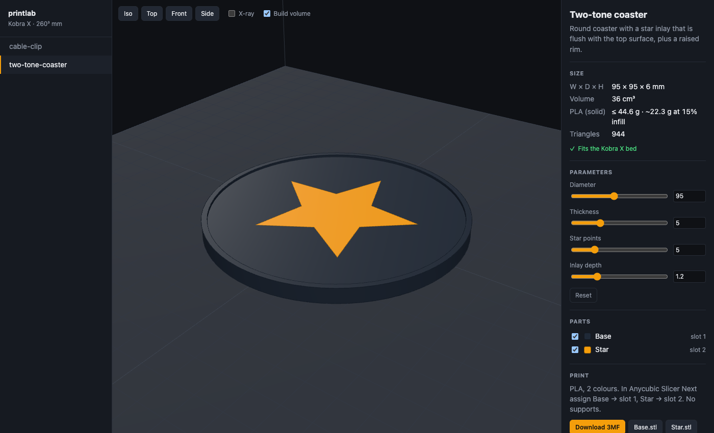

# printlab

Describe a 3D-printable object in plain English, get a parametric model you can spin around in the browser, then export a print-ready 3MF for the **Anycubic Kobra X** (or any FDM printer).

Models are short TypeScript files built on [Manifold](https://github.com/elalish/manifold), so they're easy for an AI coding agent (or you) to write and change, always watertight, and fully parametric.



## Quick start

```sh
npm install
npm run dev        # http://localhost:5190
```

- Pick a model on the left; orbit with the mouse.
- Drag the sliders to change parameters live.
- Check the size, filament estimate and printability checks on the right.
- **Download 3MF** and open it in Anycubic Slicer Next or OrcaSlicer.

```sh
npm run check              # validate every model (fits bed, watertight, overlaps)
npm run export cable-clip  # write out/cable-clip.3mf + STLs
```

## Making a model with an AI agent

Open the repo in Claude Code (or another agent) and describe what you want:

> A wall hook for a bike helmet, 40 mm deep, two screw holes, rounded edges.

The agent follows [`CLAUDE.md`](CLAUDE.md), writes `models/<name>.ts`, runs `npm run check`, and the browser reloads with the new model. Ask for changes ("make the hook deeper", "add my initials in a second colour") and iterate.

## Writing a model by hand

```ts
import { defineModel } from '../src/lib/model';

export default defineModel({
  title: 'Box',
  description: 'A simple open box.',
  params: { size: { value: 40, min: 10, max: 120, label: 'Size' } },
  build: ({ Manifold }, p) => {
    const outer = Manifold.cube([p.size, p.size, p.size / 2], true).translate(0, 0, p.size / 4);
    const inner = Manifold.cube([p.size - 4, p.size - 4, p.size / 2], true).translate(0, 0, p.size / 4 + 2);
    return [{ name: 'Box', color: '#3b82f6', shape: outer.subtract(inner) }];
  },
});
```

Return several parts with different colours for multi-colour prints — each becomes its own filament slot in the slicer.

## Docs

- [Kobra X notes](docs/kobra-x.md) — specs, slicer workflow, design rules
- [Open-source projects](docs/open-source.md) — what we use and what we could add

## License

MIT
